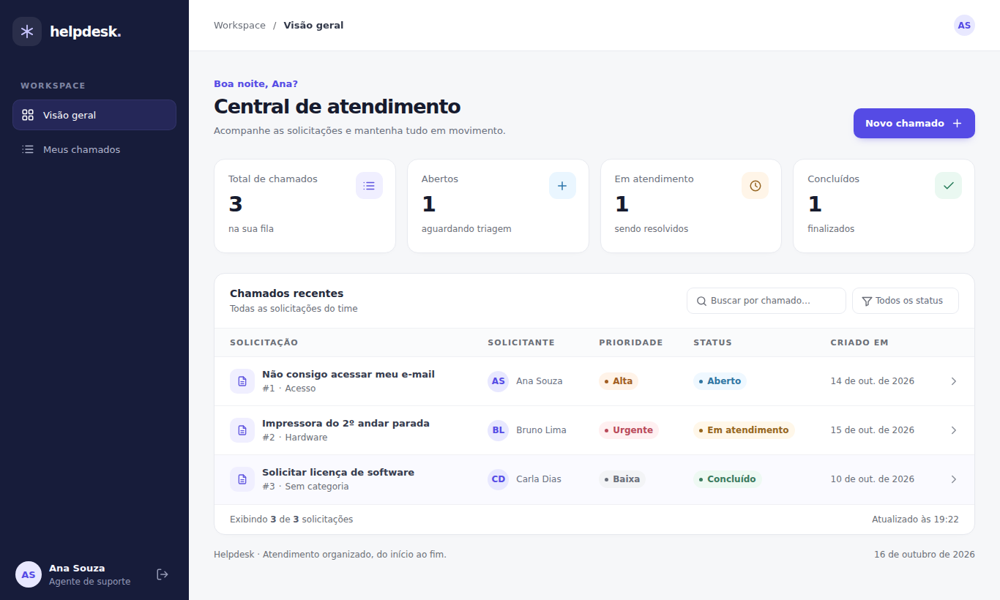

# Helpdesk — Frontend

Interface web de uma central de atendimento (helpdesk): login, painel com resumo de chamados, busca e filtros, abertura de chamados, conversa por comentários e fluxo de status para agentes. Consome a **Helpdesk API** (REST + token Bearer).




## Destaques

- **Arquitetura por feature** (`auth`, `tickets`), com camada de serviços isolada e componentes de UI reutilizáveis.
- **Cliente HTTP único**: injeta o token, normaliza erros em `ApiError`, trata falha de rede e encerra a sessão em `401/419`.
- **Sessão robusta**: `AuthContext`, expiração automática de JWT, storage protegido contra indisponibilidade.
- **Dados sem desperdício**: requisições canceláveis (`AbortController`), respostas obsoletas descartadas, lista atualizada localmente após ações e revalidada ao voltar para a aba.
- **Acessibilidade**: diálogos com foco preso/restaurado, `Esc`, `aria-*`, tabela semântica, navegação completa por teclado, contraste mínimo 4.5:1 e `prefers-reduced-motion`.
- **Responsivo**: sidebar em gaveta no mobile (sem foco enquanto fechada).
- **Qualidade**: ESLint (React, Hooks e jsx-a11y), Prettier, testes unitários com Vitest e CI no GitHub Actions.

## Stack

React 19 · Vite 6 · CSS puro modular (sem dependências de UI) · ESLint 9 · Prettier · Vitest

## Como rodar

Pré-requisitos: Node.js 20+ e a Helpdesk API rodando em `http://127.0.0.1:8000`.

```bash
npm install
cp .env.example .env     # opcional: ajuste VITE_API_BASE_URL
npm run dev              # http://localhost:5173
```

Em desenvolvimento, as chamadas a `/api` passam pelo proxy do Vite (veja `vite.config.js`), evitando CORS.

| Script                 | O que faz                      |
| ---------------------- | ------------------------------ |
| `npm run dev`          | Servidor de desenvolvimento    |
| `npm run build`        | Build de produção em `dist/`   |
| `npm run preview`      | Serve o build localmente       |
| `npm run lint`         | Análise estática (ESLint)      |
| `npm run format`       | Formata o código (Prettier)    |
| `npm test`             | Testes unitários (Vitest)      |

### Variáveis de ambiente

| Variável            | Padrão | Descrição                                  |
| ------------------- | ------ | ------------------------------------------ |
| `VITE_API_BASE_URL` | `/api/v1` | URL base da API (sem barra final)       |

## Estrutura

```
src/
├── app/                  # composição da aplicação (App, Dashboard)
├── config/               # leitura de variáveis de ambiente
├── services/             # httpClient, tokenStorage, sessionEvents (sem React)
├── hooks/                # hooks genéricos (useDialog)
├── utils/                # funções puras (formatters)
├── components/
│   ├── layout/           # AppShell, Sidebar, Topbar
│   └── ui/               # Button, Badge, Avatar, Icon, Modal, Drawer, Dialog…
├── features/
│   ├── auth/             # AuthContext, LoginPage, roles, token, authApi
│   └── tickets/          # TicketsPage, hooks, API, constantes, seletores
│       └── components/   # TicketList, TicketRow, TicketStats, drawer, modal…
└── styles/               # CSS por área (base, login, layout, tickets, modals)
tests/                    # testes unitários
```

Regras de dependência: `features` usam `components`, `services` e `utils`; `components/ui` e `services` **não** importam de `features`.

## Contrato esperado da API

Rotas relativas a `VITE_API_BASE_URL` (`/api/v1`).

| Método | Rota                       | Uso                                  |
| ------ | -------------------------- | ------------------------------------ |
| POST   | `/login`                   | `{ email, password }` → `{ token, user }` |
| POST   | `/logout`                  | Encerra o token                      |
| GET    | `/categories`              | `{ data: [{ id, name, description }] }` (só ativas) |
| GET    | `/tickets`                 | `{ data: [...] }`                    |
| GET    | `/tickets/:id`             | Detalhe com `comments`               |
| POST   | `/tickets`                 | `{ category_id, title, description, priority }` |
| POST   | `/tickets/:id/comments`    | `{ comment }`                        |
| PATCH  | `/tickets/:id/status`      | `{ status }`                         |

Status: `OPEN → IN_PROGRESS → WAITING/CLOSED`. Prioridades: `LOW`, `MEDIUM`, `HIGH`, `URGENT`.
Erros de validação (`{ errors: { campo: [msg] } }`) e `{ message }` são exibidos ao usuário.

## Decisões e trade-offs

- **Token em `sessionStorage`**: simples e encerra ao fechar a aba, mas é legível por JavaScript (risco em caso de XSS). Em produção, o ideal é cookie `HttpOnly` + `SameSite` emitido pela API, junto a uma CSP restritiva.
- **Sem router**: há uma única área autenticada; a navegação lateral só alterna o escopo da lista. `react-router` entra quando surgirem telas com URL própria.
- **Filtros no cliente**: adequado para listas pequenas. Com volume maior, mover busca/filtro/paginação para a API.

## Próximos passos

- Paginação e filtros no servidor.
- Testes de componentes (Testing Library) e E2E (Playwright).
- Migração para TypeScript.
